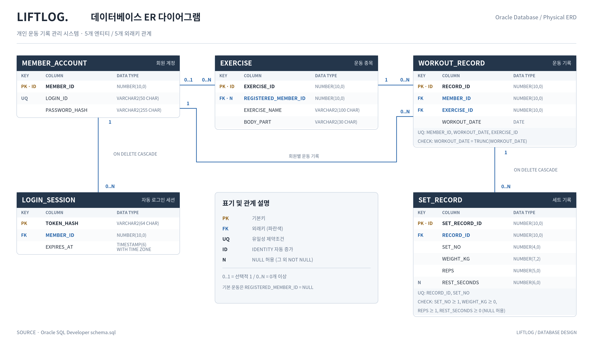

# LIFTLOG.

개인 운동 기록 관리 시스템

Java Swing과 Oracle Database를 기반으로 개발한
개인 맞춤형 근력 운동 기록 관리 애플리케이션입니다.

## 01. 프로젝트 소개

LIFTLOG는 운동 종목별 중량, 반복 횟수, 휴식시간을
기록하고 과거 운동 기록과 비교하여 개인의 운동 성장을
체계적으로 관리할 수 있도록 개발한 프로그램입니다.

기존 운동 기록 방식의 불편함을 개선하고,
직관적이고 간결한 사용자 인터페이스를 제공하는 것을
목표로 합니다.

## 02. 주요 기능

### 회원 관리
- 회원가입 및 로그인
- 자동 로그인 및 로그아웃
- 회원별 운동 기록 관리
- PBKDF2 기반 비밀번호 해싱

### 운동 기록
- 6개 운동 부위 및 기본 운동 34종 제공
- 사용자 맞춤 운동 종목 등록 및 관리 (기록이 연결된 종목의 수정·삭제 제한)
- 운동 이름 검색, 부위별 선택 및 최근 운동 조회
- 중량, 반복 횟수, 휴식시간 기록 및 세트별 완료 처리
- 다음 세트 자동 생성 및 입력하지 않은 자동 생성 세트의 저장 방지
- 이전 루틴의 날짜, 부위, 종목을 확인하고 운동 불러오기
- 같은 세트 번호의 이전 중량·반복 횟수와 현재 입력값 실시간 비교

### 기록 관리
- 날짜별 운동 기록 조회
- 운동 이름 검색 및 날짜·부위별 필터
- 운동 기록 상세 조회, 수정 및 삭제
- 개별 종목 또는 날짜 단위로 기록을 선택하여 일괄 삭제
- 검색·필터 적용 시 표시된 기록만 일괄 선택하고 삭제 전 확인
- 이전 운동과 현재 운동의 최고 중량, 총 반복 횟수, 운동량 및 세트별 기록 비교

### 운동 통계
- 1주, 1개월, 전체 기간별 통계
- 운동 일수, 총 세트 수 및 운동 종목 수 확인
- 종목별 최고 중량 및 운동량 그래프
- 역대 최고 중량 및 최다 반복 횟수 확인

## 03. 개발 환경

| 구분 | 기술 |
| --- | --- |
| Language | Java 17 |
| IDE | IntelliJ IDEA |
| Database | Oracle Database Free |
| Database Tool | Oracle SQL Developer |
| Database Connection | JDBC (ojdbc11 23.26.4.0.0) |
| UI Framework | Java Swing, FlatLaf 3.6.2 |
| Build Tool | Maven |
| Environment | Docker |
| Version Control | Git, GitHub |
| Font | Pretendard |

## 04. 프로젝트 구조

```text
JavaTermProject
├── src
│   └── main
│       ├── java
│       │   └── workout_management
│       │       ├── controller
│       │       ├── domain
│       │       ├── repository
│       │       ├── util
│       │       ├── view
│       │       └── Main.java
│       └── resources
│           └── fonts
├── sql
│   ├── schema.sql
│   └── exercise_data.sql
├── docs
│   ├── LIFTLOG_ERD.drawio
│   └── LIFTLOG_ERD.png
├── .gitignore
├── pom.xml
└── README.md
```

| 패키지 | 역할 |
| --- | --- |
| controller | 비즈니스 로직 및 입력값 검증 |
| domain | 데이터 객체 및 모델 정의 |
| repository | JDBC 및 데이터베이스 접근 |
| util | 인증, 보안 및 공통 테마 관리 |
| view | 사용자 인터페이스 및 화면 구성 |

## 05. 데이터베이스 설계

| 테이블 | 설명 |
| --- | --- |
| MEMBER_ACCOUNT | 회원 계정 정보 |
| EXERCISE | 기본 및 사용자 등록 운동 종목 |
| WORKOUT_RECORD | 날짜별 운동 기록 |
| SET_RECORD | 세트별 중량, 횟수, 휴식시간 |
| LOGIN_SESSION | 자동 로그인 세션 정보 |

기본키와 외래키를 활용하여 데이터 간 관계를 관리하며,
UNIQUE 및 CHECK 제약조건을 통해 데이터의
중복 저장과 잘못된 값의 입력을 방지합니다.

### ER Diagram



[ER 다이어그램 원본 (draw.io)](docs/LIFTLOG_ERD.drawio)

## 06. 설치 및 실행 방법

### 데이터베이스 준비

1. Oracle Database Free를 실행합니다.
2. termproject 데이터베이스 사용자를 준비합니다.
3. Oracle SQL Developer에서 해당 사용자로 접속합니다.
4. 비어 있는 스키마에서 `sql/schema.sql`을 스크립트 실행(F5)으로 실행하여 테이블 5개를 생성합니다.
5. `sql/exercise_data.sql`을 스크립트 실행하여 기본 운동 34종을 등록합니다.

기존 데이터베이스에 테이블이 이미 존재하는 경우 `schema.sql`을 다시 실행하지 않습니다.

### 데이터베이스 연결 설정

- Host: localhost
- Port: 1521
- Service Name: FREEPDB1
- Username: termproject

JDBC 연결 주소:

```text
jdbc:oracle:thin:@//localhost:1521/FREEPDB1
```

데이터베이스 비밀번호는 IntelliJ IDEA 실행 설정의
환경변수 `DB_PASSWORD`에 등록합니다.

비밀번호는 소스코드와 공개 저장소에 포함하지 않습니다.

### 프로그램 실행

1. IntelliJ IDEA에서 프로젝트를 엽니다.
2. Maven 의존성을 불러옵니다.
3. Java SDK 17을 설정합니다.
4. DB_PASSWORD 환경변수를 설정합니다.
5. workout_management.Main 클래스를 실행합니다.
6. 회원가입 후 로그인하여 프로그램을 사용합니다.

## 07. 사용자 인터페이스

- 다크 모드 기반의 미니멀한 디자인
- Pretendard 서체 적용
- 일관된 색상 및 둥근 카드 디자인
- 홈, 기록, 통계 하단 내비게이션
- 운동 부위별 정보 분류
- 불필요한 화면 이동과 반복 입력 최소화
- 이전 운동 루틴 카드 및 현재 입력값의 증가·감소 색상 표시
- 완료된 세트와 입력 중인 세트의 시각적 구분
- 날짜별 기록 카드에서 개별·일괄 선택 지원

## 08. 보안 및 데이터 무결성

- PreparedStatement를 활용한 SQL 인젝션 방지
- PBKDF2-SHA256 기반 비밀번호 해싱
- 자동 로그인 토큰의 해시 저장 및 30일 만료시간 관리
- 회원별 데이터 접근 제한
- 트랜잭션을 활용한 최초 운동 기록과 첫 세트의 동시 저장
- 마지막 세트 삭제 시 빈 운동 기록 정리
- 데이터베이스 제약조건을 활용한 데이터 검증
- `.gitignore`를 통한 IDE 개인 설정, 빌드 결과물, 환경변수 파일의 Git 추적 제외

## 09. 프로젝트 개발 목적

운동을 꾸준히 수행하면서 발생하는 다양한 기록을
효율적으로 관리하고, 과거 운동과 현재 운동을
비교할 수 있는 프로그램을 직접 개발하고자 하였습니다.

Java 객체지향 프로그래밍, JDBC, 관계형 데이터베이스,
GUI 설계 및 Git 기반 버전 관리 기술을
하나의 프로젝트에 적용하였습니다.

---

LIFTLOG. | Personal Workout Journal